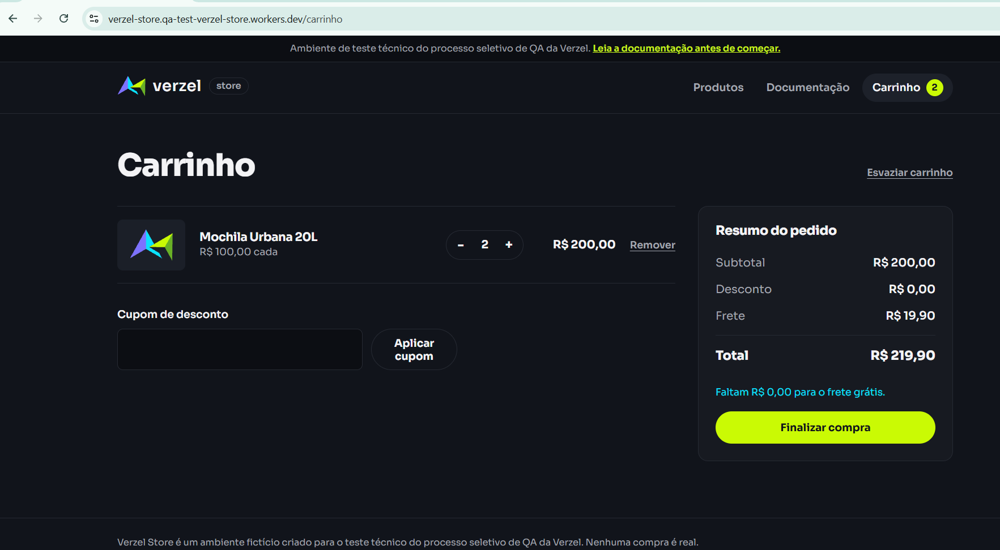
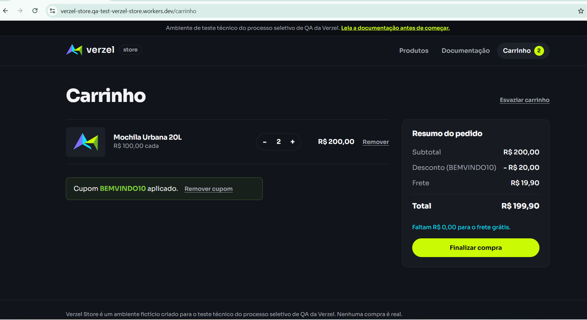
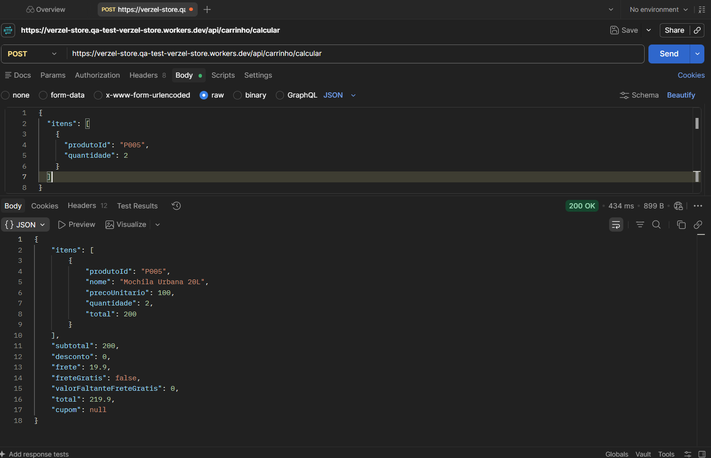
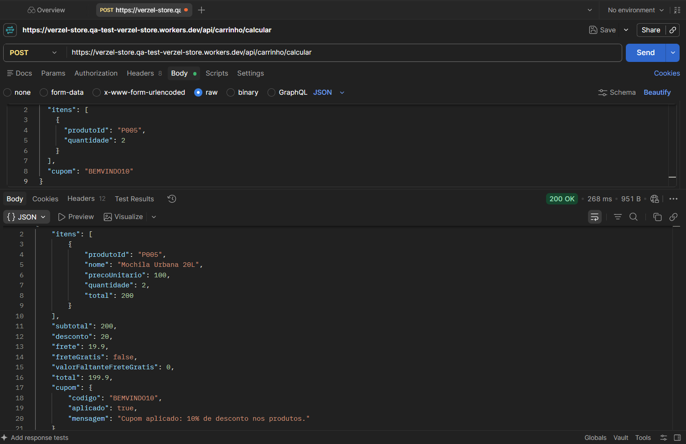

# BUG-001 - Frete grátis não aplicado quando o subtotal é exatamente R$ 200,00

## 1. Informações gerais

| Campo | Valor |
|---|---|
| **ID** | BUG-001 |
| **Título** | Frete grátis não aplicado quando o subtotal é exatamente R$ 200,00 |
| **Tipo** | Bug funcional / Regra de negócio |
| **Status** | Aberto |
| **Severidade** | Alta |
| **Prioridade** | Alta |
| **Reportado por** | José Lucas Mendes dos Santos |
| **Data de abertura** | 09/10/2026 |
| **Card** | VZS-142 |
| **Critérios de aceite** | CA06 e CA08 |
| **Casos de teste relacionados** | CT-011, CT-015, CT-023 e CT-035 |
| **Camadas afetadas** | Interface (UI) e API |

**Justificativa da severidade:** o defeito gera cobrança indevida ao cliente, descumpre uma regra de negócio documentada (CA06) e não possui workaround pela interface. A prioridade é alta pelo impacto direto no valor do pedido e na confiança do cliente.

## 2. Ambiente de teste

| Item | Valor |
|---|---|
| **Aplicação** | Verzel Store - Ambiente de QA |
| **Versão** | 2.3.0 |
| **URL** | https://verzel-store.qa-test-verzel-store.workers.dev/ |
| **Sistema operacional** | Windows 11 Version 26H2 |
| **Navegador / versão** | Google Chrome 154.0.8037.58 |
| **Ferramenta de API** | Postman |

## 3. Descrição do defeito

Ao realizar uma compra com subtotal exatamente igual a R$ 200,00, o sistema não aplica o benefício de frete grátis e cobra indevidamente R$ 19,90.

O comportamento ocorre na interface da loja e na API de cálculo do carrinho (`POST /api/carrinho/calcular`). O defeito também ocorre com o cupom `BEMVINDO10`, embora a regra do frete grátis deva considerar o subtotal **antes** do desconto.

> Trata-se de **um defeito com duas camadas afetadas** (UI e API). Se a correção for feita apenas na API, a UI deve ser reverificada.

## 4. Referência da documentação

- **CA06:** o frete é grátis para compras com subtotal a partir de R$ 200,00, inclusive.
- **CA08:** a regra do frete grátis considera o subtotal antes do desconto do cupom.

Portanto, qualquer carrinho com subtotal igual ou superior a R$ 200,00 deve apresentar frete de R$ 0,00.

## 5. Cenário 1 - Reprodução pela interface (UI)

**Casos relacionados:** CT-011 e CT-015

### Pré-condições

- Acessar a Verzel Store no ambiente de QA.
- Iniciar com o carrinho vazio.
- Produto P005 - Mochila Urbana 20L disponível, com preço unitário de R$ 100,00.

### Passos para reprodução

1. Acessar a loja.
2. Adicionar duas unidades do produto P005 - Mochila Urbana 20L ao carrinho.
3. Abrir o carrinho.
4. Conferir o subtotal de R$ 200,00.
5. Verificar o valor do frete e o total da compra.
6. Aplicar o cupom `BEMVINDO10`.
7. Conferir novamente o desconto, o frete e o total.

### Resultado esperado

**Sem cupom (CT-011)**

| Campo | Valor esperado |
|---|---|
| Subtotal | R$ 200,00 |
| Desconto | R$ 0,00 |
| Frete | R$ 0,00 |
| Total | R$ 200,00 |

**Com cupom (CT-015)**

| Campo | Valor esperado |
|---|---|
| Subtotal | R$ 200,00 |
| Desconto | R$ 20,00 |
| Frete | R$ 0,00 |
| Total | R$ 180,00 |

### Resultado obtido

**Sem cupom (CT-011)**

| Campo | Valor obtido |
|---|---|
| Subtotal | R$ 200,00 |
| Desconto | R$ 0,00 |
| Frete | R$ 19,90 |
| Total | R$ 219,90 |

**Com cupom (CT-015)**

| Campo | Valor obtido |
|---|---|
| Subtotal | R$ 200,00 |
| Desconto | R$ 20,00 |
| Frete | R$ 19,90 |
| Total | R$ 199,90 |

**Divergência:** o sistema cobra R$ 19,90 de frete em ambos os cenários, contrariando CA06 e CA08.

## 6. Cenário 2 - Reprodução pela API

**Casos relacionados:** CT-023 e CT-035

**Endpoint:** `POST /api/carrinho/calcular`

**Header:** `Content-Type: application/json`

### Teste A - Sem cupom (CT-023)

**Como executar no Postman:**

| Configuração | Valor |
|---|---|
| **Método** | `POST` |
| **URL** | `https://verzel-store.qa-test-verzel-store.workers.dev/api/carrinho/calcular` |
| **Headers** | `Content-Type: application/json` |
| **Body** | selecionar `raw` e o formato `JSON` |

**Body (colar na aba Body):**

```json
{
  "itens": [
    {
      "produtoId": "P005",
      "quantidade": 2
    }
  ]
}
```

Depois, clicar em **Send** e conferir o status e o JSON retornado.

**Resultado esperado:**

```json
{
    "itens": [
        {
            "produtoId": "P005",
            "nome": "Mochila Urbana 20L",
            "precoUnitario": 100,
            "quantidade": 2,
            "total": 200
        }
    ],
    "subtotal": 200,
    "desconto": 0,
    "frete": 0,
    "freteGratis": true,
    "valorFaltanteFreteGratis": 0,
    "total": 200,
    "cupom": null
}
```

HTTP 200.

**Resultado obtido:** HTTP 200, porém com frete cobrado.

```json
{
    "itens": [
        {
            "produtoId": "P005",
            "nome": "Mochila Urbana 20L",
            "precoUnitario": 100,
            "quantidade": 2,
            "total": 200
        }
    ],
    "subtotal": 200,
    "desconto": 0,
    "frete": 19.9,
    "freteGratis": false,
    "valorFaltanteFreteGratis": 0,
    "total": 219.9,
    "cupom": null
}
```


### Teste B - Com cupom (CT-035)

**Como executar no Postman:**

| Configuração | Valor |
|---|---|
| **Método** | `POST` |
| **URL** | `https://verzel-store.qa-test-verzel-store.workers.dev/api/carrinho/calcular` |
| **Headers** | `Content-Type: application/json` |
| **Body** | selecionar `raw` e o formato `JSON` |

**Body (colar na aba Body):**

```json
{
  "itens": [
    {
      "produtoId": "P005",
      "quantidade": 2
    }
  ],
  "cupom": "BEMVINDO10"
}
```

Depois, clicar em **Send** e conferir o status e o JSON retornado.

**Resultado esperado:**

```json
{
    "itens": [
        {
            "produtoId": "P005",
            "nome": "Mochila Urbana 20L",
            "precoUnitario": 100,
            "quantidade": 2,
            "total": 200
        }
    ],
    "subtotal": 200,
    "desconto": 20,
    "frete": 0,
    "freteGratis": true,
    "valorFaltanteFreteGratis": 0,
    "total": 180,
    "cupom": {
        "codigo": "BEMVINDO10",
        "aplicado": true,
        "mensagem": "Cupom aplicado: 10% de desconto nos produtos."
    }
}
```

HTTP 200.

**Resultado obtido:** HTTP 200, com `freteGratis: false`.

```json
{
    "itens": [
        {
            "produtoId": "P005",
            "nome": "Mochila Urbana 20L",
            "precoUnitario": 100,
            "quantidade": 2,
            "total": 200
        }
    ],
    "subtotal": 200,
    "desconto": 20,
    "frete": 19.9,
    "freteGratis": false,
    "valorFaltanteFreteGratis": 0,
    "total": 199.9,
    "cupom": {
        "codigo": "BEMVINDO10",
        "aplicado": true,
        "mensagem": "Cupom aplicado: 10% de desconto nos produtos."
    }
}
```


**Divergência:** a API não reconhece o subtotal de R$ 200,00 como elegível ao frete grátis.

## 7. Impacto do defeito

O defeito provoca cobrança indevida de frete em pedidos que atendem ao valor mínimo estabelecido.

- Cobrança adicional de R$ 19,90 ao cliente.
- Descumprimento da regra de negócio CA06.
- Inconsistência no cálculo do total do pedido.
- Possível impacto na confiança do cliente e na conclusão da compra.

## 8. Evidências

Pasta: `03-evidencias/BUG-001/screenshots`

| Caso | Camada | Arquivo |
|---|---|---|
| CT-011 | UI, sem cupom |  |
| CT-015 | UI, com cupom |  |
| CT-023 | API, sem cupom |  |
| CT-035 | API, com cupom |  |


## 9. Critério de aceite da correção e reteste

**Comportamento esperado após a correção:** o sistema deve aplicar frete grátis sempre que o subtotal for maior ou igual a R$ 200,00, independentemente da aplicação de cupons de desconto.

**Plano de reteste:**

- Reexecutar CT-011, CT-015, CT-023 e CT-035 (UI e API).
- Regressão por valor limite, com e sem cupom `BEMVINDO10`:
  - R$ 199,70 → frete de R$ 19,90
  - R$ 200,00 → frete de R$ 0,00
  - R$ 209,80 → frete de R$ 0,00
- Confirmar que o valor do frete e o total estão corretos tanto na UI quanto na API.