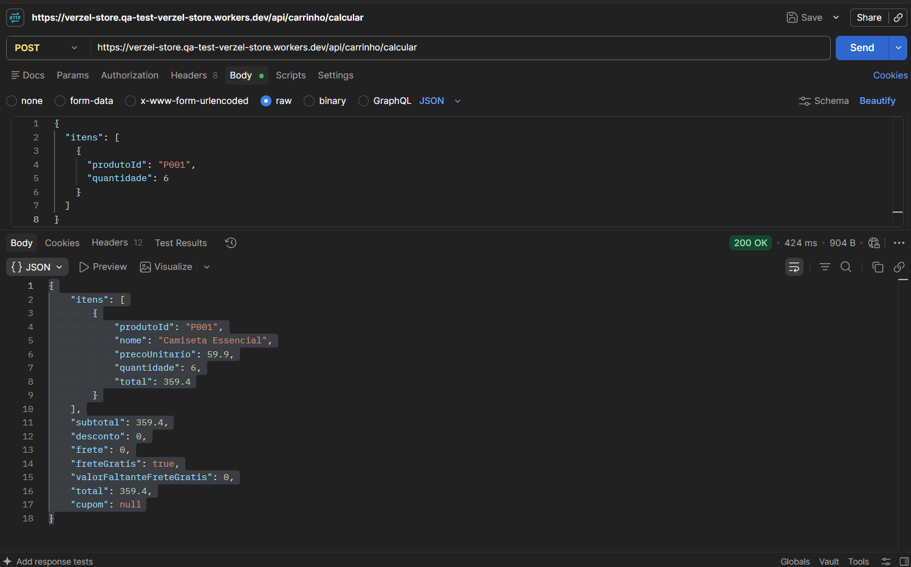
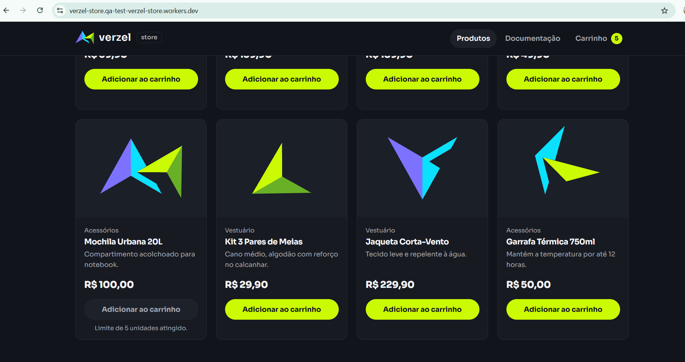

# BUG-002 - API permite quantidade superior ao limite de 5 unidades por produto

## 1. Informações gerais

| Campo | Valor |
|---|---|
| **ID** | BUG-002 |
| **Título** | API permite quantidade superior ao limite de 5 unidades por produto |
| **Tipo** | Bug funcional / Validação de regra de negócio |
| **Status** | Aberto |
| **Severidade** | Alta |
| **Prioridade** | Alta |
| **Reportado por** | José Lucas Mendes dos Santos |
| **Data de abertura** | 09/10/2026 |
| **Card** | VZS-142 |
| **Critérios de aceite** | CA10 |
| **Casos de teste relacionados** | CT-034 (API-07B) |
| **Camadas afetadas** | API |

**Justificativa da severidade:** o defeito permite que requisições ultrapassem o limite máximo de unidades por produto estabelecido na regra de negócio. A prioridade é alta porque a API aceita uma operação que deveria ser rejeitada, comprometendo a validação dos dados independentemente das restrições aplicadas na interface.

## 2. Ambiente de teste

| Item | Valor |
|---|---|
| **Aplicação** | Verzel Store - Ambiente de QA |
| **Versão** | 2.3.0 |
| **URL** | https://verzel-store.qa-test-verzel-store.workers.dev/ |
| **Sistema operacional** | Windows 11 Version 26H2 |
| **Navegador / versão** | Google Chrome 154.0.8037.58 |
| **Ferramenta de API** | Postman |

## 3. Descrição do defeito

A API de cálculo do carrinho permite informar uma quantidade superior ao limite máximo de **5 unidades por produto**, contrariando o critério de aceite CA10.

Ao enviar uma requisição com **6 unidades do produto P001 - Camiseta Essencial**, o endpoint `POST /api/carrinho/calcular` retorna **HTTP 200**, aceitando a quantidade informada.

De acordo com a documentação, a API deveria rejeitar a requisição com **HTTP 422** e o código de erro `QUANTIDADE_MAXIMA_EXCEDIDA`.

O defeito foi identificado na validação da API. A interface possui uma restrição para impedir a adição de mais de cinco unidades, conforme o resultado do CT-017.

## 4. Referência da documentação

**CA10:** o sistema deve permitir, no máximo, 5 unidades de cada produto por pedido, tanto na interface quanto na API.

**Contrato de erros da API:**

- **HTTP esperado:** `422 Unprocessable Entity`
- **Código esperado:** `QUANTIDADE_MAXIMA_EXCEDIDA`
- **Condição:** quantidade superior a 5 unidades por produto.

Portanto, uma requisição contendo 6 unidades do mesmo produto deve ser rejeitada pela API.

## 5. Reprodução pela API

**Casos relacionados:** CT-034 (API-07B)

### Pré-condições

- API da Verzel Store disponível no ambiente de QA.
- Postman configurado para realizar requisições HTTP.
- Produto P001 - Camiseta Essencial disponível.
- Header `Content-Type: application/json` configurado.

### Passos para reprodução

1. Abrir o Postman.
2. Selecionar o método `POST`.
3. Informar o endpoint `/api/carrinho/calcular`.
4. Configurar o header `Content-Type: application/json`.
5. Selecionar `Body > raw > JSON`.
6. Informar o corpo da requisição com 6 unidades do produto P001.
7. Clicar em **Send**.
8. Verificar o status HTTP e a resposta retornada.

**Endpoint:** `POST /api/carrinho/calcular`

**Header:** `Content-Type: application/json`

**Como executar no Postman:**

| Configuração | Valor |
|---|---|
| **Método** | `POST` |
| **URL** | `https://verzel-store.qa-test-verzel-store.workers.dev/api/carrinho/calcular` |
| **Headers** | `Content-Type: application/json` |
| **Body** | selecionar `raw` e o formato `JSON` |

**Body (colar na aba Body):**

```json
{
  "itens": [
    {
      "produtoId": "P001",
      "quantidade": 6
    }
  ]
}
```

### Resultado esperado

A API deve rejeitar a requisição porque a quantidade informada ultrapassa o limite máximo permitido.

**Status HTTP esperado:** `422`

**Código de erro esperado:** `QUANTIDADE_MAXIMA_EXCEDIDA`

A requisição não deve ser considerada válida para o cálculo do carrinho.

### Resultado obtido

A API retornou **HTTP 200**, permitindo o processamento da requisição com 6 unidades do produto P001.

**Status HTTP obtido:** `200`

**Comportamento observado:** a quantidade superior ao limite foi aceita, sem retornar o erro `QUANTIDADE_MAXIMA_EXCEDIDA`.

**Divergência:** a API não aplica corretamente a validação do limite máximo de 5 unidades por produto, contrariando o critério de aceite CA10.

## 6. Validação complementar - Interface (UI)

**Casos relacionados:** CT-017

O teste realizado na interface confirmou que a aplicação impede a adição de uma sexta unidade do mesmo produto ao carrinho.

**Resultado esperado:** a interface deve impedir quantidades superiores a 5 unidades por produto.

**Resultado obtido:** a interface respeitou o limite estabelecido.

**Status do CT-017:** Passou.

**Observação:** embora a interface aplique a restrição, a API aceita uma requisição direta com quantidade superior ao limite.

Isso demonstra que a validação realizada na interface não é suficiente para garantir o cumprimento da regra de negócio pela API.

## 7. Impacto do defeito

O defeito permite que requisições enviadas diretamente à API ultrapassem o limite máximo estabelecido para cada produto.

**Impactos identificados:**

- Descumprimento do critério de aceite CA10.
- Aceitação de quantidades inválidas pela API.
- Inconsistência entre as validações da interface e da API.
- Possibilidade de cálculos com quantidades superiores ao limite permitido.

## 8. Evidências

Pasta: `03-evidencias/BUG-002/screenshots`

| Caso | Camada | Arquivo |
|---|---|---|
| CT-034 | API, quantidade superior ao limite |  |
| CT-017 | UI, limite de 5 unidades (evidência complementar) |  |


## 9. Critério de aceite da correção e reteste

**Comportamento esperado após a correção:** a API deve rejeitar requisições que contenham mais de 5 unidades de um mesmo produto, retornando HTTP 422 e o código `QUANTIDADE_MAXIMA_EXCEDIDA`.

**Plano de reteste:**

- Reexecutar o CT-034 e confirmar o retorno HTTP 422.
- Validar o código de erro `QUANTIDADE_MAXIMA_EXCEDIDA`.
- Reexecutar o CT-017 para verificar se a interface continua respeitando o limite.
- Realizar testes de regressão por valor limite:

  * **4 unidades:** requisição aceita.
  * **5 unidades:** requisição aceita.
  * **6 unidades:** requisição rejeitada com HTTP 422.
- Confirmar que a API não realiza o cálculo do carrinho para uma requisição com quantidade inválida.

**Status:** Aberto - aguardando correção.
