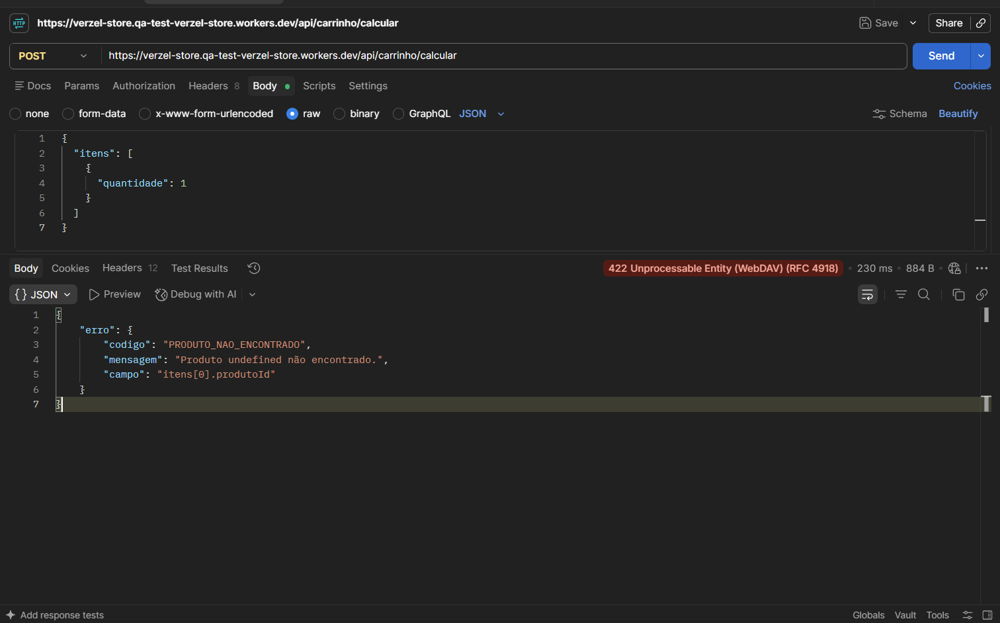
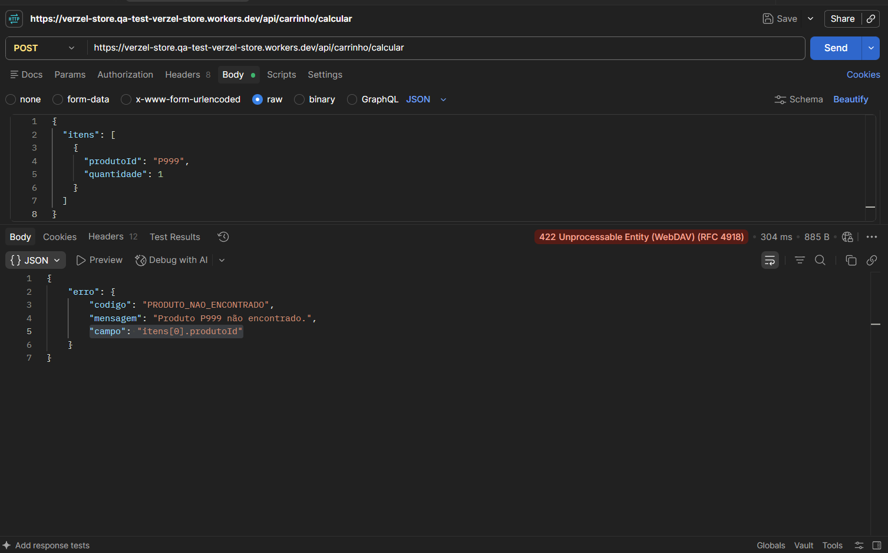

# BUG-003 - API retorna código de erro incorreto quando produtoId não é informado

## 1. Informações gerais

| Campo | Valor |
|---|---|
| **ID** | BUG-003 |
| **Título** | API retorna código de erro incorreto quando produtoId não é informado |
| **Tipo** | Bug funcional / Validação de dados e tratamento de erros |
| **Status** | Aberto |
| **Severidade** | Média |
| **Prioridade** | Média |
| **Reportado por** | José Lucas Mendes dos Santos |
| **Data de abertura** | 09/10/2026 |
| **Card** | VZS-142 |
| **Critérios de aceite** | Contrato de erros da API |
| **Casos de teste relacionados** | CT-045 (API-13) |
| **Camadas afetadas** | API |

**Justificativa da severidade:** o defeito não impede que a API rejeite a requisição inválida, pois o status HTTP 422 é retornado corretamente. Entretanto, o código de erro não corresponde à condição identificada, comprometendo a consistência do contrato da API e podendo prejudicar aplicações que dependem desses códigos para tratar erros.

A prioridade é média porque a falha afeta o tratamento e a interpretação dos erros, sem evidência de comprometimento direto dos cálculos ou da criação de pedidos.

## 2. Ambiente de teste

| Item | Valor |
|---|---|
| **Aplicação** | Verzel Store - Ambiente de QA |
| **Versão** | 2.3.0 |
| **URL** | https://verzel-store.qa-test-verzel-store.workers.dev/ |
| **Sistema operacional** | Windows 11 Version 26H2 |
| **Navegador / versão** | Google Chrome 154.0.8037.58 |
| **Ferramenta de API** | Postman |

## 3. Descrição do defeito

Ao enviar uma requisição para o endpoint `POST /api/carrinho/calcular` contendo um item sem o campo obrigatório `produtoId`, a API retorna **HTTP 422** com o código de erro `PRODUTO_NAO_ENCONTRADO`.

Entretanto, de acordo com o contrato de erros da API, a ausência do campo `produtoId` deve ser classificada como `ITEM_INVALIDO`, pois o objeto enviado não contém todos os campos obrigatórios.

Além disso, a mensagem retornada apresenta o valor `undefined` no lugar do identificador do produto:

`Produto undefined não encontrado.`

O comportamento indica que a API trata a ausência de `produtoId` como se fosse uma referência a um produto inexistente, em vez de identificar inicialmente a estrutura inválida do item.

## 4. Referência da documentação

**Contrato de erros da API:**

- **HTTP 422 - `ITEM_INVALIDO`:** ocorre quando um item não é um objeto válido contendo os campos obrigatórios `produtoId` e `quantidade`.
- **HTTP 422 - `PRODUTO_NAO_ENCONTRADO`:** ocorre quando o item informa um identificador de produto que não existe no catálogo.

**Regra esperada:** quando `produtoId` não é informado, a API deve retornar o código `ITEM_INVALIDO`.

O código `PRODUTO_NAO_ENCONTRADO` deve ser utilizado quando um identificador é informado, mas não corresponde a um produto existente.

Portanto, os dois erros representam condições diferentes e devem ser tratados de acordo com o contrato documentado.

## 5. Cenário 1 - Reprodução pela API

**Casos relacionados:** CT-045 (API-13)

### Pré-condições

- API da Verzel Store disponível no ambiente de QA.
- Postman configurado para realizar requisições HTTP.
- Header `Content-Type: application/json` configurado.
- Corpo da requisição contendo um item sem o campo `produtoId`.

### Passos para reprodução

1. Abrir o Postman.
2. Selecionar o método `POST`.
3. Informar o endpoint `/api/carrinho/calcular`.
4. Configurar o header `Content-Type: application/json`.
5. Selecionar `Body > raw > JSON`.
6. Informar um objeto no array `itens` contendo apenas o campo `quantidade`.
7. Clicar em **Send**.
8. Conferir o status HTTP, o código de erro e a mensagem retornada.

**Endpoint:** `POST /api/carrinho/calcular`

**Header:** `Content-Type: application/json`

**Como executar no Postman:**

| Configuração | Valor |
|---|---|
| **Método** | `POST` |
| **URL** | `https://verzel-store.qa-test-verzel-store.workers.dev/api/carrinho/calcular` |
| **Headers** | `Content-Type: application/json` |
| **Body** | selecionar `raw` e o formato `JSON` |

**Body (colar na aba Body):**

```json
{
  "itens": [
    {
      "quantidade": 1
    }
  ]
}
```

### Resultado esperado

A API deve rejeitar a requisição porque o item não contém o campo obrigatório `produtoId`.

**Status HTTP esperado:** `422`

**Código de erro esperado:** `ITEM_INVALIDO`

**Exemplo de resposta esperada:**

```json
{
  "erro": {
    "codigo": "ITEM_INVALIDO",
    "mensagem": "Um item não é um objeto com produtoId e quantidade."
  }
}
```

### Resultado obtido

A API retornou **HTTP 422**, porém com o código de erro incorreto.

**Status HTTP obtido:** `422`

**Código de erro obtido:** `PRODUTO_NAO_ENCONTRADO`

**Mensagem obtida:** `Produto undefined não encontrado.`

**Trecho da resposta observada:**

```json
{
  "erro": {
    "codigo": "PRODUTO_NAO_ENCONTRADO",
    "mensagem": "Produto undefined não encontrado.",
    "campo": "itens[0].produtoId"
  }
}
```

**Divergência:** a API identifica a ausência de `produtoId` como um produto inexistente, retornando `PRODUTO_NAO_ENCONTRADO` em vez de `ITEM_INVALIDO`, contrariando o contrato de erros documentado.

## 6. Cenário 2 - Validação complementar de produto inexistente

**Casos relacionados:** CT-051 (API-13)

O CT-051 verifica o comportamento da API quando um identificador de produto é informado, mas não existe no catálogo.

Nesse cenário, a requisição utiliza um identificador inexistente, como `P999`.

**Body utilizado:**

```json
{
  "itens": [
    {
      "produtoId": "P999",
      "quantidade": 1
    }
  ]
}
```

**Resultado esperado:**

- HTTP 422.
- Código de erro `PRODUTO_NAO_ENCONTRADO`.

**Resultado obtido:**

A API retornou o erro esperado.

**Status do CT-051:** Passou.

**Observação:** o CT-051 demonstra que o código `PRODUTO_NAO_ENCONTRADO` é válido quando existe um identificador informado que não corresponde a um produto cadastrado.

Entretanto, no CT-045, o campo `produtoId` não foi informado, caracterizando uma estrutura inválida.

Assim, a API deve distinguir os dois cenários e retornar o código correspondente a cada condição.

## 7. Impacto do defeito

O defeito compromete a consistência do tratamento de erros da API.

**Impactos identificados:**

- Descumprimento do contrato de erros documentado.
- Retorno de código incompatível com a condição identificada.
- Mensagem de erro pouco clara, contendo o valor `undefined`.
- Possível dificuldade no tratamento de erros por aplicações consumidoras da API.
- Dificuldade adicional para diagnóstico e identificação da causa da falha.

## 8. Evidências

Pasta: `03-evidencias/BUG-003/screenshots`

| Caso | Camada | Arquivo |
|---|---|---|
| CT-045 | API, campo produtoId ausente |  |
| CT-051 | API, produto inexistente (evidência complementar) |  |

## 9. Critério de aceite da correção e reteste

**Comportamento esperado após a correção:** a API deve identificar a ausência do campo obrigatório `produtoId` e retornar HTTP 422 com o código `ITEM_INVALIDO`.

O código `PRODUTO_NAO_ENCONTRADO` deve permanecer reservado aos casos em que um identificador de produto é informado, mas não existe no catálogo.

**Plano de reteste:**

- Reexecutar o CT-045 e confirmar HTTP 422 com o código `ITEM_INVALIDO`.
- Verificar se a mensagem de erro descreve adequadamente a ausência do campo obrigatório.
- Reexecutar o CT-051 para confirmar que produtos inexistentes continuam retornando `PRODUTO_NAO_ENCONTRADO`.
- Realizar testes de regressão para os seguintes cenários:

  - **`produtoId` ausente:** HTTP 422 — `ITEM_INVALIDO`.
  - **`produtoId` inexistente (`P999`):** HTTP 422 — `PRODUTO_NAO_ENCONTRADO`.
  - **`produtoId` válido (`P001`):** requisição aceita, desde que os demais dados sejam válidos.
  - **`quantidade` ausente:** HTTP 422 — `ITEM_INVALIDO`.

- Confirmar que a API retorna os códigos de erro conforme o contrato documentado.

**Status:** Aberto - aguardando correção.
